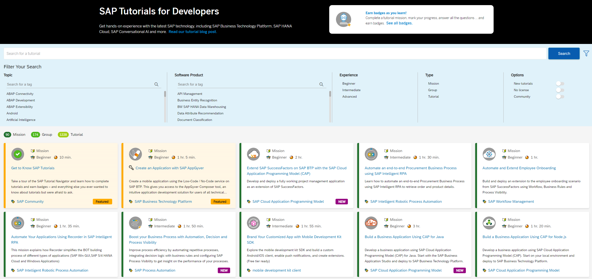
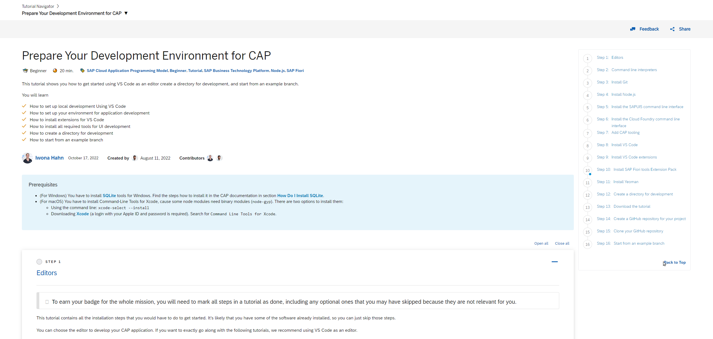
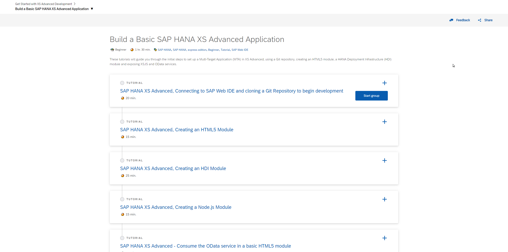
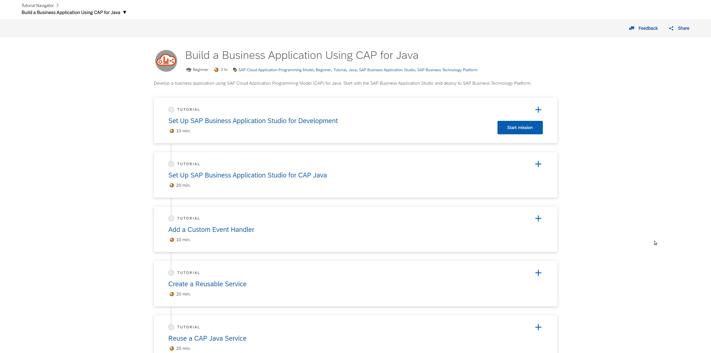
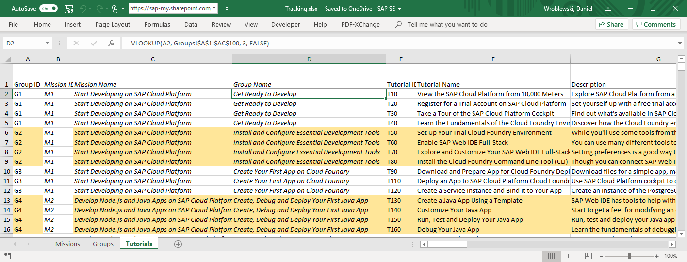
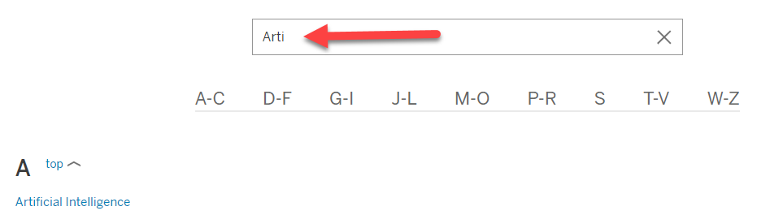
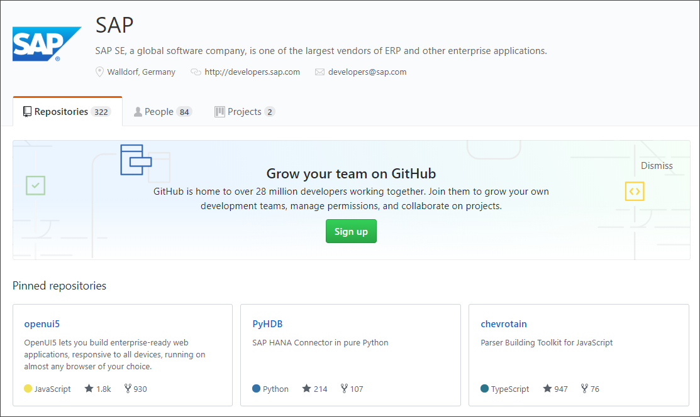

# The Big Picture on Tutorials
<!-- description --> This is a high-level introduction to SAP Developer Tutorial system. It describes the system and outlines the tasks and processes that tutorial authors need to understand to create and maintain effective content.

## Topics  
  - The purpose of our tutorials
  - How tutorials are organized for our customer developers
  - The high-level process for creating and publishing tutorials
  - How to plan your tutorials
  - **Your responsibilities when creating tutorials**

## Introduction
> **IMPORTANT:** If you haven't already done so, visit our [SAP Build Work Zone Workspace](https://workzone.one.int.sap/site#workzone-home&/groups/A7NmsKmoG9vVaxizKhdQOk/overview_page/r9dX7mvdcXW5KMmWvG2NYl).

>If you have any questions, write to <riley.rainey@sap.com>.

### What are Developer Tutorials?

First and foremost, SAP Developer Tutorials are a logical extension to SAP's trial resources.  Folks can sign up for these trials, but what should they do next?  This Tutorial system delivers hands-on guidance to help folks get environments set up and then explore SAP frameworks and tools at their own pace.  

Each tutorial is organized into a relatively small chunk of learning -- it is packaged to be completed in no more than 30 minutes of a user's time.  You'll see in a moment how these chunks can be connected together to achieve more complex goals too.

As a potential tutorial author, here's some considerations to keep in mind:

  - **Tutorials do not replace documentation** - tutorials provide an important way to provide extensions to technical documentation, but should never be thought of as a replacement.  If something you are demonstrating in a tutorial doesn't appear in SAP's core documentation, consider reporting it to the proper owners.

  - **Subject Matter** - think about what a developer might actually need to construct using your tool or service.  Can you provide a simple working example that illustrates an anticipated use case?  Can you demonstrate SAP best practices, SAP naming conventions, or other core SAP APIs or services along the way?  Tutorials offer a way to demonstrate these in an integrated fashion that can help developers write better code.

  - **Not just "What", but "Why"** - All along the way, look for opportunities to explain context. What is being accomplished in a particular step?  Why is that step essential to the larger task? Explaining these elements makes for a more engaging experience; consider:

    - What does a step do?
    - What is happening in the background that might not be apparent to the developer?
    - What are the ramifications of what they just did?
    - Would they do this any differently productive environment?
    - What did they accomplish at the completion of the tutorial?

### SAP Tutorial Navigator

Our tutorials made visible to the public in the [SAP Tutorial Navigator](https://developers.sap.com/tutorial-navigator.html).

Roughly 1,400 tutorials are published today.  Tutorials can be filtered by SAP product name, topic, general keywords and target experience level.  Newly published or freshly updated content is featured at the top of the list.

### Important Terms

A **Tutorial** describes a logically complete task. Something that takes just a few minutes to complete (e.g., get trial account, enable a service).  

We'll explore it more deeply later, but Tutorials are authored in an SAP-specific extended form of [Markdown](https://www.markdownguide.org/getting-started/). Within a Tutorial's Markdown source file, the Tutorial you will break down the larger task into specific **Steps**. Steps will also be described in a later tutorial.

Individual Tutorials can be combined in a planned sequence. This is called a "**Group**". For example, a Group might be composed of Tutorials that result in creating a simple application from beginning to end. The number of Tutorials in a Group varies. It will depend on the work you are describing but, in practice, Groups are often composed of three to five tutorials. And it's typical to require an hour to complete a Group.

[View Groups in the Tutorial Navigator](https://developers.sap.com/tutorial-navigator.html?tag=tutorial:type/group)

As an example, the Tutorial you are reading now is the first in the Group titled, "[Create Developer Tutorials](https://developers-prod-aqua.wcms-prod.c.eu-de-2.cloud.sap/group.docs-tutorial.html)".  The Tutorial system is flexible in that it allows folks to start at a Group, or dive directly into a specific Tutorial.  Wherever applicable, the Tutorial system will add navigation hints at the top of page to make it easy traverse between Tutorials or to visit the parent Group, regardless of their entry point.

Tutorials and Groups can be combined into a **Mission**. A Mission demonstrates more complete information for learning a skill.

A Missions also can provide incentive to be completed.  As the author, you can specify that the developer should receive a SAP Community Badge upon successful completion. These badges can be displayed by the user in their SAP Community profile to demonstrate their exposure to particular tools or topics.

We also utilize Missions at face-to-face SAP events.  For example, at SAP TechEd we often will have a reserved area called the SAP App Space (or "Developer Garage").  In this area, show attendees can sit down at pre-configured machines, execute Missions and, upon completion, receive "swag": t-shirts, mugs, and other prizes.

[View Missions in the Tutorial Navigator](https://developers.sap.com/tutorial-navigator.html?tag=tutorial:type/mission)

### Planning

As an author, you will find that planning is an important starting point for creating an effective collection of Tutorials. 

Look ahead a few months to what missions and tutorials you'll want for your topic. A six to twelve month window is a good starting point. Start with an outline of tasks that need to be described.  Find a logical order for these and break those down into Tutorials. As you flesh out what each tutorial describes, you'll get a sense of the time required for each.

You can break-up larger tutorials and still keep them logically connected using Groups.  

If the content might be useful at an event or if it merits Community recognition, consider making that a Mission rather than a Group.

> ### Get Help in Planning
>  - Work with a SAP Developer Advocate in your product area. The Advocate is extremely knowledgeable about SAP technologies and the other published tutorials, and will be responsible for approving all tutorials. It will probably save effort to find one and work with them from the outset.

>For the most up-to-date list of Advocates, see [Developer Advocates](https://sap.sharepoint.com/sites/201750/SitePages/Developer-Advocates.aspx). If you cannot find an advocate for your area, contact [`Tom Jung`](https://people.wdf.sap.corp/profiles/I809764). He leads the Developer Advocates team.

>- For ideas on how to construct missions, see the [SAP Business Technology Platform missions](https://developers.sap.com/topics/cloud-platform.html#tutorials).

>- You can also download a [planning Excel](https://jam4.sapjam.com/groups/6Jr8GG1khjmOoSVZPK2GhG/documents/qS7lEZAJnlnbSnEWiVKQoM) template to help you organize your tutorials. Before authoring, you should outline the titles, descriptions, and times for all missions, groups, and tutorials.

>    

Once you have an outline of the tutorials you want to create, send it to your developer advocate and <a href="mailto:riley.rainey@sap.com">Riley Rainey</a>.

### Tutorial Development

In later Tutorials in this Group, we'll go through the details of Tutorials development and upkeep.  But we can summarize it here. The primary tools you'll be working with are VS Code and GitHub. The general flow looks like this:

- You'll plan the Tutorials, Groups, and Mission you want to create.
- You create Tutorials using VS Code operating in a non-public QA environment.  You'll use VS Code's Markdown editing and preview capabilities to get a rapid look at your results.
- You can also do a very accurate preview in QA by committing your test code into the QA GitHub repository.  This will automatically publish your Tutorial to a QA web site exactly as it would appear on the developers.sap.com.
- Once you are close to publishing the Tutorials, communicate information about the Groups and Missions to our team. Groups and Tutorials are defined using a supporting
  system called IMS.  
- Publish your Tutorials by submitting a GitHub Pull Request in the Production repo.  We'll coordinate merging the Tutorials and adding the Missions and Groups with you.
- Voila. Published.
- Monitor the Production GitHub repository for incoming issues and comments.  Respond in a timely manner.
- Periodically review your Tutorials. Update as needed to respond to any changes to your product or an underlying system. Record your reviews in our IMS system.
- Production updates are made via Production Pull Requests.
-  When you need to retire a Tutorial, you can delete it from the Production system.  This retirement should be coordinated with us, as we might need to also retire or modify any associated Groups or Missions.

### Test, test, test

> "The first draft reveals the art; revision reveals the artist.”

>> — Michael Lee

When creating tutorials:

1. Check how they look on the QA preview web site. Inspect closely.

2. Test them yourself, from beginning to end.

    Think about how someone outside of SAP (with trial account) could follow and complete the tasks, and could answer your validations/questions.

3. Have QA test them.

4. Have a developer/UA unfamiliar with your product test them.

    Though QA will generally test for accuracy, a developer/UA will test for usability.

5. Finally, look them over when they are in production.

### Your Responsibilities

Authoring tutorials comes with important commitments.

  - **Keep your content up to date:** Periodically recheck that your tutorials to ensure they still work. Dependent system change and this sometimes requires adjusted instructions or updating a screen shot.

  - Tutorial operations are supported by an internal system called IMS. A key function of this system is to help ensure that content is reviewed regularly.  When you review a Tutorial, you can record that in IMS. Where IMS finds that a Tutorial hasn't been reviewed in six months, the author be sent an automated reminder.

  - **Answer customer issues:** Each tutorial has a **Feedback** link that lets users open an [issue](https://github.com/SAPDocuments/Tutorials/issues).

    Please provide a first response within two business days.

  - **Alert us about ownership changes:** If you change roles and someone else is now responsible for the tutorials, alert us.  If they are new to SAP Tutorials, we can help onboard them.
  
    You will also see that the identify of the Tutorial owner is recorded as metadata in the source file.  When a change of ownership occurs, update the Tutorial source file.

### Metadata Tagging
Tutorials support metadata tagging.  Tags are essential to content search and analytics. Each tutorial has a primary tag. It can also have zero or more supplemental tags.

SAP Tutorial tagging is closely aligned with SAP standards. That core SAP system is called [**Semaphore**](https://wiki.one.int.sap/wiki/pages/viewpage.action?pageId=4740712730). You can inspect available tags using the [IMS Tags Page](https://imsprod-approuter.cfapps.us30.hana.ondemand.com/ui/tags) to locate the tags relevant to your content.  You can copy the coded tag from the `MD format` column for use in a Tutorial. We'll describe the details in a subsequent tutorial.

>If you are unable to reach the **IMS Tags Page** please contact <a href="mailto:riley.rainey@sap.com">Riley Rainey</a>.

>**IMPORTANT:** Tags are maintained by a central group outside Developer Relations not connected to the tutorials. New tags can be added, but that may require interactions with the Semaphore and Community teams.

- If a tag that you know exists does not appear in the IMS Tags Page, please request that we add it. The best way to see what tags are available is to go to the [Blogs - All Tags](https://blogs.sap.com/tags/) page and use the **Filter community tags** field to search for tags,

    <!-- border; size:800px -->
    

- If you need to request the creation of a new tag, please create a ticket to the [Metadata group](https://dsrequest.int.sap/list/0/create?basketId=0&requestToExtend=). Set the **Request Area** to `Digital Governance` and the **Request Type** to `Tags / Metadata` If it is only for tutorials, mark the request for **Developers** (in the **Additional Info** area). If you also want it for the SAP Community, you can mark it for **Community**.  

### Sample Code

There may be times when you don't want developers to start from scratch, but instead download a skeleton project or other executable. In such cases, Tutorials might not be the best approach.  SAP's Open Source Program Office offers a streamlined process to publish code samples through GitHub.  Although this isn't managed through our team, here's the basics:

You can set this up on [SAP's GitHub account](https://github.com/SAP), but must go through SAP's [Sample Code Publication Process](https://wiki.one.int.sap/wiki/display/SimplSuite/Sample+Publishing+Code+Process+-+Summary+of+all+steps).

Budget about a week for the approval process. Pay special attention to ensure that your project only depends upon public SAP APIs. The process is essentially:

  - Project review and approvals (2-3 days)
  - Move project to SAP-samples organization on GitHub (2-3 days)

To get started, contact <a href="mailto:DL_5E90B3AB0E43648C2A5D04FF@global.corp.sap">DL SAP Sample Code Admins</a>.

### Summary

In this Tutorial, we've looked at the overall system, tools, and dependencies.  In the next section, we'll dive into properly configuring your machine for Tutorial development.  At that point, you'll be ready to really dive into your Tutorial creation journey.