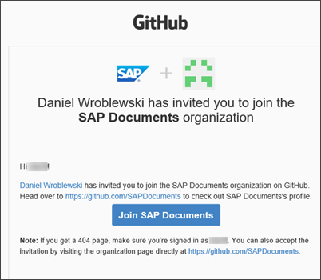
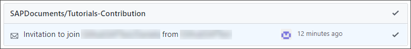
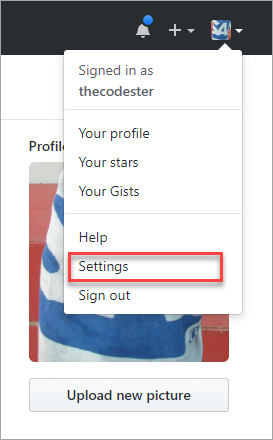
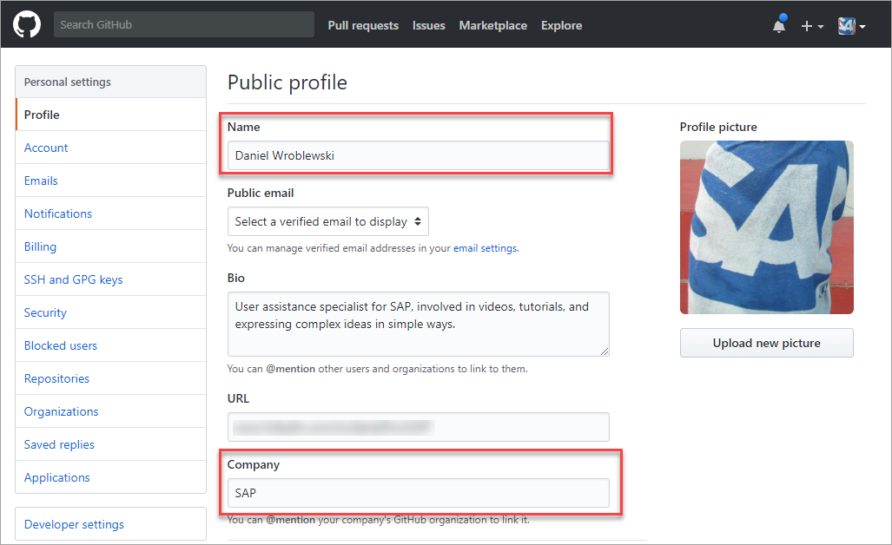
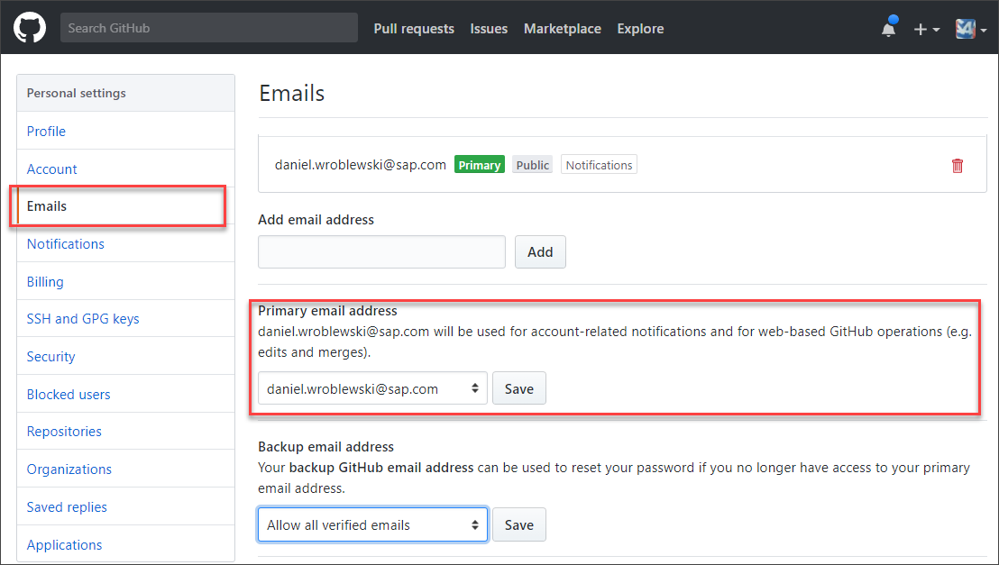
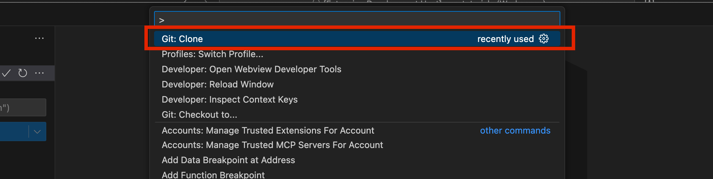
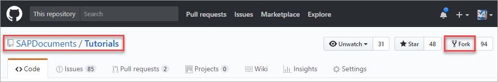
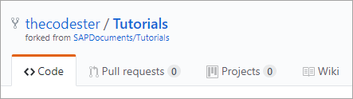

# Configure your machine for Tutorial Authoring
<!-- description --> Set up your environment to write tutorials, including installing all the necessary tools.

## You will learn  
 - How to plan for writing tutorials
 - How to install the necessary tools
 - How to clone the requisite GitHub repositories

## Prerequisites
 - Writing developer tutorials requires a few simple tools, such as for running scripts to help you create and test your tutorials, as well as updating the tutorial GitHub repository with your files. To write tutorials, you will need to be familiar with the following:
 - **Markdown**: Markdown is an easy-to-use markup language, similar to wiki markup, for building a structured documents. It is worth 20 minutes to get familiar with Markdown.
    - If you are unfamiliar with Markdown, check out this [this reference](http://commonmark.org/help/) and this [10-minute tutorial](http://commonmark.org/help/tutorial/).
    - On GitHub, however, we use `GitHub Flavored Markdown`, which has [differences to traditional Markdown](https://help.github.com/articles/github-flavored-markdown/) like table, code block syntax highlighting, and URL auto linking.
    - If you're already familiar with Markdown but need to refresh your memory, check out the [Markdown Cheat Sheet](https://github.com/adam-p/markdown-here/wiki/Markdown-Cheatsheet).
      *Our [style guide](https://github.com/sap-tutorials/Tutorials-Contribution/blob/master/templates/styleguide.md) provides guidance on the Markdown formatting you'll need for tutorials.*
 - **GitHub**: GitHub is a widely used source control system, and you will use it to check in and check out your files. You will be able to interact with git primarily
 through VS Code, but it still will be useful for you to understand at these git operations:
      - fork
      - clone
      - pull
      - commit
      - push
      - pull request (this is an operation specific to GitHub)
      - merge
      - [Understanding the `Github flow`](https://guides.github.com/introduction/flow/)
      - [GitHub Hello World](https://guides.github.com/activities/hello-world/)
    -  [GitHub Overview & Training Webcasts](https://www.youtube.com/playlist?list=PLg7s6cbtAD15Das5LK9mXt_g59DLWxKUe)
      *You won't have to do complex stuff with Git -- and our plugin provides menu options so you can bypass it for the most part. Still, you should be familiar with how Git works -- you will need sometimes to work directly with Git.*
  - **SAP Open Source Program Office Standards**: the SAP Developer Tutorials system operates within SAP's OSPO Framework.  You will need to register your GitHub account with the [OSPO sap-tutorials organization](https://wiki.one.int.sap/wiki/spaces/ospodocs/pages/2228907903/Self-Service+for+Joining+an+SAP+GitHub+Organization) before authoring Tutorials.
  - You will need these user accounts an permissions:
    - A personal [GitHub](https://github.com/) account
    - Permission to the [Tutorial-Contributions](https://github.com/sap-tutorials/Tutorials-Contribution) repository in the [sap-tutorials](https://github.com/sap-tutorials) GitHub account. You can get access to the sap-tutorials organization via the [Open Source Portal](https://portal.opensource.tools.sap/).
      *This should have been taken care of when following the instructions in the [Developer Tutorial Authors](https://teams.microsoft.com/l/channel/19%3A6EbgThwH454hgKLLg5CAnFG4gc9M3PCxv0Ko2zRHD8U1%40thread.tacv2/Developer%20Tutorial%20Authors?groupId=189541d0-ea24-4064-8fba-ee848177c342&tenantId=42f7676c-f455-423c-82f6-dc2d99791af7&ngc=true&allowXTenantAccess=true) Microsoft Teams channel.*
    - Registration as a Content Author in the Tutorials Admin UI.  You can visit the [Tutorials Admin UI](https://developers.sap.com/admin-ui/) to determine whether you currently have access.  If access is prohibited, request access via the [Developer Tutorial Authors](https://teams.microsoft.com/l/channel/19%3A6EbgThwH454hgKLLg5CAnFG4gc9M3PCxv0Ko2zRHD8U1%40thread.tacv2/Developer%20Tutorial%20Authors?groupId=189541d0-ea24-4064-8fba-ee848177c342&tenantId=42f7676c-f455-423c-82f6-dc2d99791af7&ngc=true&allowXTenantAccess=true) Microsoft Teams channel.

If you have deeper questions, contact [`Thomas Jung`](https://people.wdf.sap.corp/profiles/I809764).
  
>If you are given permission manually, you will receive an email to join the sap-tutorials organization.

>

>If you lose the email, you can always go to your notifications on GitHub by clicking ...

>

>... in the upper right and accept the invitation there.

>

>Alternatively, you can go to the [sap-tutorials](https://github.com/sap-tutorials) organization on GitHub and accept the invitation there.

## Introductions
The goal of this tutorial is to configure your machine with all the tool needed to create and maintain tutorial content.

### Install Required Software
Install the following tools on your workstation:

| Tool                                                 | Description         | Install Notes |
| :--------------------------------------------------  |---------------------|---------------| 
| [Visual Studio Code](https://code.visualstudio.com/) (Stable Build for PC or Mac)                     | Visual Studio Code is a code editor redefined and optimized for building and debugging modern web and cloud applications. Subsequent set up and tutorial management steps will use examples from Visual Studio Code; however, any markdown editor can be used to author and revise tutorials.|  Run installer with defaults.  | 
| [Git for Windows](http://gitforwindows.org/) or [Git for Mac](https://gist.github.com/derhuerst/1b15ff4652a867391f03#file-mac-md) | Git lets you interact with our GitHub repositories. <div>&nbsp;</div><div> **NOTE: This is different from GitHub Desktop.**</div>    | This step is optional.  VS Code will provide access to git and GitHub. Run installer with defaults.  | 

### Identify the Tutorials Repositories used by your team

The tutorial system operates using two tiers of
   GitHub repositories; one for QA and one for Production.  We'll start by cloning the appropriate QA repository. For historical reasons, QA repos will always have "-Contribution" suffix.  There are many QA repositories, many used by specific SAP product teams (see the table below).  Most teams operate from the "Tutorials-Contribution" QA repo -- consult other members of your team if you are unsure which is appropriate.

| Tutorial team | QA GitHub URL |
|-----------------------------------------------------------:|--------------------------------------|
| abap-core-development | https://github.com/sap-tutorials/abap-core-development-Contribution
| btp-adai | https://github.com/sap-tutorials/btp-adai-Contribution
| btp-dev-guidance | https://github.com/sap-tutorials/btp-dev-guidance-Contribution
| btp-foundation | https://github.com/sap-tutorials/btp-foundation-Contribution
| devtoberfest-2022 | https://github.com/sap-tutorials/devtoberfest-2022-Contribution
| btp-foundation | https://github.com/sap-tutorials/sap-btp-sdk-android-Contribution
| sap-btp-sdk-ios | https://github.com/sap-tutorials/sap-btp-sdk-ios-Contribution
| sap-build-apps | https://github.com/sap-tutorials/sap-build-apps-Contribution
| sap-build-process-automation | https://github.com/sap-tutorials/sap-build-process-automation-Contribution
| sap-mobile-development-kit | https://github.com/sap-tutorials/sap-mobile-development-kit-Contribution
| xpa-tutorials | https://github.com/sap-tutorials/xpa-tutorials-Contribution |
| **everyone else** | https://github.com/sap-tutorials/Tutorials-Contribution |


The companion Production repository will have a URL with the "-Contribution" suffix removed.

Make a note of URLs, as we'll reference them in the next steps.

### Configure VS Code

1. You may now switch to [this tutorial-SAGE Getting Started](https://developers.sap.com/tutorials-qa/sage-getting-started) - we recently created a custom VS Code extension designed specifically to streamline Tutorial authoring.  Pick up the steps in that Tutorial.  You may safely skip the remaining steps below.

### Manually Create a VS Code Workspace

2. Create a "sap-tutorials" directory in your local home directory. We'll do all work there.

3. Start VS Code

4. Install the latest release of the [Sage Tutorial Content Authoring Extension](https://github.tools.sap/developer-relations/sage-tutorial-extension/releases).

5. Install the ["Spellright" spelling extension](https://marketplace.visualstudio.com/items?itemName=ban.spellright) into VS Code by following [the instructions at the Microsoft VS Code web site](https://code.visualstudio.com/docs/editor/extension-marketplace)
6. Select "File > Open Folder..."; select the "sap-tutorials" directory in your home directory.

7. Select "Save as Workspace..."; navigate to the "sap-tutorials" directory and name the new workspace something like "my-tutorials". Click "Save".  
  
On future VS Code sessions, you can restore your tutorials working environment quickly by selecting "File > Open Recent >" and the selecting this "my-tutorials" Workspace.

>**IMPORTANT FOR MAC USERS:**

> - Cache your GitHub credentials by following the instructions [here](https://help.github.com/articles/caching-your-github-password-in-git/#platform-mac).


### Update GitHub account
Go to [GitHub](https://github.com/), sign in, and open your profile settings.



Make sure your name is listed properly, and add a picture. Your GitHub name, and your picture, will appear as the author when you publish tutorials. Also fill in your company.



Make sure to verify your email address and set it as your primary email address. This will be the email to identify your commits.



### Set up SSH

To work smoothly with the plugin and to enable 2-factor authentication, it is best to set up the connection between your laptop and GitHub via SSH.

> **IMPORTANT:** Do NOT use a passphrase when setting up SSH.

1. Generate a new SSH key, as described in [Generating a new SSH key](https://help.github.com/en/enterprise/2.16/user/authenticating-to-github/generating-a-new-ssh-key-and-adding-it-to-the-ssh-agent).

    - Open a Bash window -- in the explorer, right-click and select **Git Bash Here**.

    - Run the following command after changing it to use your email address from GitHub:

        ```Bash
        ssh-keygen -t rsa -b 4096 -C "your_email@example.com"
        ```

        Press **Enter** and leave blank both the directory and the passphrase.

    >2 files are generated in the `.ssh` directory of your user folder -- `id_rsa` and `id_rsa.pub`, private and public keys. For me, the proper/default directory was the `C:\Users\I031617.GLOBAL\.ssh` folder.

    >If you want to check the SSH keys you have, run the command: `ls -al ~/.ssh`

2. Copy your public SSH key (i.e., `id_rsa.pub`) to your GitHub profile.

    On GitHub, go to **profile icon | Settings | SSH and GPG keys**, and then click **New SSH Key**.

    Enter any title and your public key.

### Clone the QA Repository

If you installed the Sage VS Code Extension, this step will have been completed for you during setup - you may skip this step here.

1. In VS Code, select "View > Command Palette..."

2. Select "Git:Clone".  Enter the appropriate URL selected from the table above (see (1) below).  Note that the "Tutorials-Contribution" repository is quite large, if that's the repo you are cloning, it will take several minutes to complete.



### Fork the companion Production repository

Using a browser, visit the **Production repository** URL appropriate for your team; for example, [`sap-tutorials/Tutorials`](https://github.com/sap-tutorials/Tutorials) repository.  In all cases, the Production repository has no `-Contribution` suffix.

Click "Fork".



Visit your account home page on GitHub, `https://github.com/`\<github-username\>

The Fork operation created a new repository in your account with the name corresponding to the Production repository.  You can verify that by visiting the "Repositories" tab on your GitHub Home Page. In git terms, the original repository is the "origin" and your fork is a "downstream" repository.  We only need to fork the Production repo, and we only do that to enable the use of "Pull Requests" and review of changes before they are published in Production.



### Clone Production fork

If you installed the Sage VS Code Extension, this step will have been completed for you during setup - you may skip this step here.

Just as we cloned the `Tutorials-Contributions` repository, we'll clone the `Tutorials` repository.

>**IMPORTANT:** While you cloned the official QA repository directly from the `sap-tutorials` account, you'll now clone the Production repository from the forked repository that you just created.    

In VS Code, select "View > Command Palette..."

Select "Git:Clone".  Enter the appropriate Production URL selected from the table above.  Note that the "Tutorials" repository is quite large - if that's the repo you are cloning, it will take several minutes to complete.

### Set author name/email in Git
The author listed for a tutorial is the name on the last commit by the author who first committed the tutorial. So you need to set up the name that should appear for your commits.

Generally, setting these in the global settings is enough, but a bug in Atom sometimes requires them to be set in the individual repo you are working in.

1. Open a command prompt ( **Win+X**, then press **A** ), then run the following command, replacing `FIRST_NAME` and `LAST_NAME` with your name, and specifying your email:

    ```Git
    git config --global --replace-all user.name "FIRST_NAME LAST_NAME"
    git config --global --replace-all user.email "myemail@sap.com"
    ```

    To see your current settings, you can run:

    ```GitHub
    git config --list --global
    ```

2. Open a command prompt, and change the directory to the directory with your QA repo (e.g., `%HOME%\sap-tutorials\Tutorials-Contribution`).

    Run the following commands (changing the text to your name and email):

    ```Git
    git config user.name "FIRST_NAME LAST_NAME"
    git config user.email "MY_NAME@example.com"
    ```

3. Open a command prompt, and change the directory to the directory with your QA repo (e.g., `%HOME%\sap-tutorials\GitHub\Tutorials`).

    Run the same commands as above.

>If ever you need to change the name that appears at the top of a tutorial, add the following metadata at the start of the Markdown file for that tutorial.

```
author_name: Riley Rainey
author_profile: https://github.com/rbrainey
```

### Sign the Contributor License Agreement for the appropriate Production repo

SAP Tutorials operate within an open source framework established by the SAP Open Source Program Office and SAP's Legal team.
To merge pull requests to any production repository (e.g., `Tutorials`), you must sign the Contributor License Agreement (CLA). You can do this when you submit tur first pull request, or you can do it now.

To sign the agreement, go to [https://cla-assistant.io/sap-tutorials/Tutorials](https://cla-assistant.io/sap-tutorials/Tutorials), and press **Sign in with GitHub to agree**. You may need to authorize the CLA assistant to use your GitHub account.

>The CLA is signed for on behalf of your GitHub account, specifically for the primary email associated with your GitHub account. If you make commits that have a different email address associated with them, the CLA is not considered signed for those commits.

### Added Remarks

VS Code's Explorer View allows you to create new folders and files.  Right click on the "tutorials" folder and select "Create Folder...". Enter the tutorial "slug" name you have selected.

Within that new folder, create the Markdown file: Right-click the new folder and select "Create File...". Filename should be "\<slug-name\>.md", where \<slug-name\> matched the name of the parent directory.  This is important: there should be exactly one ".md" file in this folder and its basename must match the name of the parent folder.  This becomes the source file for the tutorial.  Any unique images that you embed in the tutorial should be placed in the folder, as well.

    - Review VS Code's Markdown editing capabilities - VS Code provides a [rich set of features to support Markdown editing](https://code.visualstudio.com/docs/languages/markdown).  This includes [Markdown Preview Pane](https://code.visualstudio.com/docs/languages/markdown#_markdown-preview).  This capability will allow you to view most, but not all of elements of your Tutorial code.

    - In addition to IDE preview, there's also a richer Tutorial preview capability available. We will describe that in just a moment.

    ### Plan your groups/missions
Before writing any tutorials, you need to do some planning with your stakeholders:

  - What high-level missions do you want to create over the next 6 to 12 months?
  - How do you want to break down the content into missions, groups, and tutorials?

Before starting to write, you should have the following information for each mission, group and tutorial:

  - Title
  - Description
  - Estimated time to complete

You'd be surprised, but working just on the titles, descriptions, and time will help you author better tutorials.
