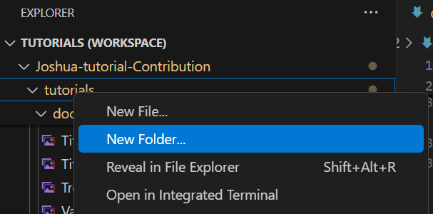
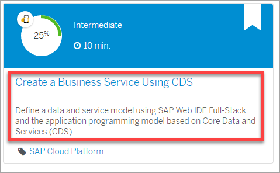
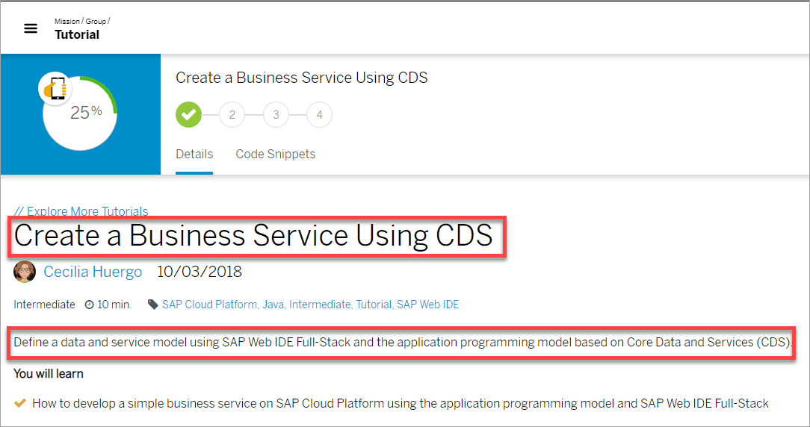
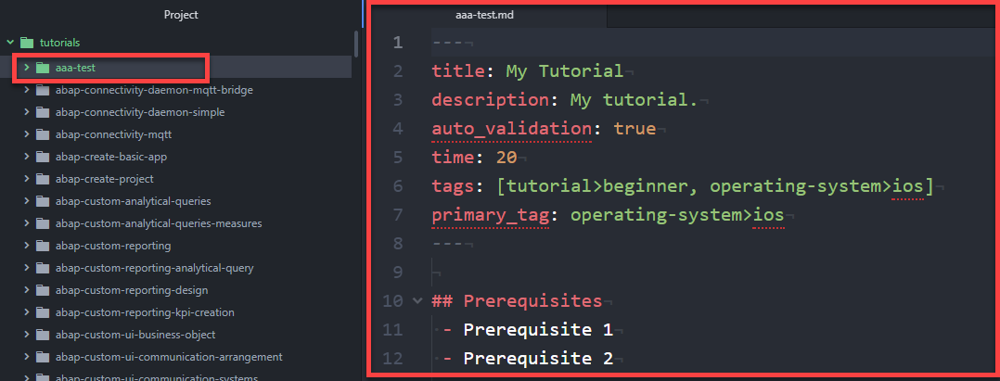
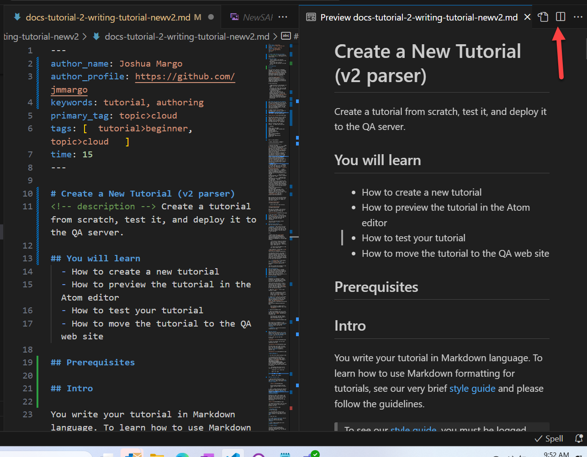
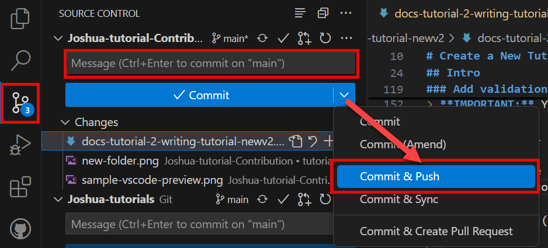

# Create a Tutorial
<!-- description --> Create a tutorial from scratch, test it, and deploy it to the QA server.  Production deployment will be described in a separate tutorial.

## You will learn  
  - How to create a new tutorial 
  - Lightweight preview using VS Code
  - How to test your tutorial
  - How to commit your tutorial to QA for detailed review and testing

## Prerequisites
  - GitHub account in the SAP Tutorials organization and assignment of **author** role
  - Markdown editor (VS Code or other) on your local machine
  - Appropriate clone of production and QA repositories on your local machine

## Intro

You write your tutorial in Markdown language. To learn how to use Markdown formatting for tutorials, see our very brief [style guide](https://github.com/SAPDocuments/Tutorials-Contribution/blob/master/templates/styleguide.md) and please follow the guidelines.

>To see our [style guide](https://github.com/SAPDocuments/Tutorials-Contribution/blob/master/templates/styleguide.md), you must be logged into GitHub and have permission to the QA repository.

A few writing tips:

  - Speak directly to the developer (if needed, use "you" and not "we" or "I").
  - Be brief, but every step or so add an explanation of what the developer is accomplishing and why.
  - Avoid future tense.
  - Make sure all SAP names (of products and services) conform to branding guidelines. If you're not sure, check with the [Approved names](https://www.sapbrandtools.com/naming-center/#/search/status-search) and with your local User Assistance professional.

---

### Create new tutorial from template
Most of the elements that you will use to author your tutorial can be found in [this tutorial](v2-example-tutorial).  For this tutorial, the examples use VS Code as the markdown editor, but you can use any markdown editor to author and publish tutorials.

To begin writing a new tutorial, navigate to the `tutorials` folder in the respective **Contribution** respository.  From that folder, select `New Folder` from the context menu.



Now that the tutorial file is created, right-click on the new folder and select `New File`.  In the text box provided, enter the name of the markdown file by using the tutorial file name with the `.md` extension.

Begin by creating the meta data section.  It should look like this:

```markdown
---
author_name: Your Name
author_profile: https://github.com/yourGitHubname 
keywords: tutorial
auto_validation: true
time: 10
tags: [ tutorial>beginner, type>tutorial ]
primary_tag: type>tutorial
parser: v2
---
```

Here is some guidance:

| Field | Description | Example |
|:---------------------------|:--------------------|:--------------------------|
| Tutorial File Name             | Name of tutorial file (plus the extension `.md`), the folder containing the tutorial file, and (eventually) the URL path (plus the extension `.html`) to your tutorial on the QA and production systems.<div>&nbsp;</div><div>Follow these rules for naming tutorials:<ul><li>Up to 6 keywords in all lowercase connected by hyphens, from general to specific </li><li>No underscores</li><li>No buzz or stop words, as described in [`stopwords.md`](https://github.com/SAPDocuments/Tutorials-Contribution/blob/master/templates/stopwords.md)</li><li>Do not use `sap`.</li><li>Less than 50 characters</li><li>No umlauts (replace them with the character plus an e)</li></ul></div>  | `cp-webide-extensions-create` |
| Tutorial Title            | Display title that says what users will build/do. Start with imperative verb, title case, not `ing`, 5-8 words | `Create an SAP Web IDE Extension` |
| Tutorial Description      | Short description under title -- similar to title just expanded to about 20 words | Create an SAP Web IDE extension to implement your own functionality within the IDE. |
| Time               | The time the average developer will need to complete the tutorial. | 20 |
| Level               | Indicates how experienced the user needs to be with the technology. | Beginner |
| Primary Tag                      | Pick the best tag that represents the tutorial's main topic/product. This tag is used to categorize the tutorial in search and on product pages.<div>&nbsp;</div><div>If you want to use a tag not in the wizard, let us know and we will add it</div> | products>sap-cloud-platform |
| Secondary Tags                      | Pick the primary tag again, plus additional tags that relate to the tutorial. </div><div>If the tutorial cannot be done on a trial system -- not recommended -- than add the `tutorial>license` tag.</div> | products>sap-cloud-platform |


When writing the title and description, make them short and to the point, and take note of how they will appear in the search results ...



... and at the top of each tutorial.



When you are finished, a new tutorial is created and the Markdown file is opened for editing in a new tab.



In the same folder, create a file called **`rules.vr`** to hold the data for creating questions for the user to answer to show they understood the material. See Step 4 for more information.

>The title and description cannot contain colons (  **:** ).

### Write your tutorial


>Include context and short explanations, so users learn as they do. Add a description at the start or end of a step explaining what they will do, or why they are doing it, and the result of what they did.

Also:

- Please review and follow the [style guide](https://github.com/SAPDocuments/Tutorials-Contribution/blob/master/templates/styleguide.md). This guide also describes the Markdown language syntax including SAP-specific extensions used in your tutorial.

    - The titles of steps are sentence case, 3-4 words, starting with an imperative verb (e.g., 'Create a file'). Make it terse. Where possible, remove "the" and "a".

    - To start any text block or image on a new line, add a blank line.

- Add validation, as described in [Add Validation to a Tutorial](docs-tutorial-3-adding-validationv2).

>In published tutorials, the author is the person who first committed the tutorial to GitHub. This is OK in most cases. But when the author leaves and a new author is now responsible, set the author by adding the following metadata at the top of the tutorial:

>    - **`author_name`**: The display name of the author (any text)
>    - **`author_profile`**: A URL to the author's profile. By convention, this should be your GitHub username.

>You must include both metadata tags if you want to manually set the author.

### Preview your tutorial as a web page
VS Code provides a very useful Markdown preview capability. While this extension doesn't understand and render SAP-specific elements, it still is handy.  A complete preview capability is available too, although it requires extra steps each time you want a new preview. It is described in Step 5.



### Add validation

The SAP Tutorial Markdown language is extended to add Validation steps.
A Validation is a question or other check. It requires user interaction. You can use Validation questions to check a user's knowledge and, maybe more importantly, emphasize key points of the tutorial.

>By convention, every tutorial should have at least one Validation question. We encourage you to consider adding more.  If a step lacks a Validation, the system will render a `[DONE]` button. This acts as a simple mechanism allowing progress tracking.

1. Tutorial Validations are defined in a `rules.vr` file.  The file must be placed tutorial's root folder (i.e., the same folder containing the tutorial's Markdown file) 

2. We'll look at a simple example here. For a more detailed review of the Validation extensions, see [Add Validation to a Tutorial](/tutorials/docs-tutorial-3-adding-validationv2.html).

    Here is a sample of validation text that will appear at the end of step three (or it can be step three if there is no other content).

    ```
    [VALIDATE_3]
    ###Rule
    single-choice

    ###Question
    True or False - Pipes are required on the outside of table content.

    ###Match
    [ ] True
    [x] False

    [VALIDATE_3]
    ```

    > In this case, "VALIDATE_3" designates this Validation is to appear at the end of Step 3. Each Validation must start and end with matching [VALIDATE_#] lines.

3. There's no specific limit to the number of Validations you define, however, you are limited to one per step. 

By convention, authors often close a tutorial by including an extra "**Test yourself**" step where they compose a validation question.

### Push tutorial to QA

1. At some point, you'll want to have a complete rendering of the tutorial's web page for review. To do that, first save all work. To activate the preview, you must ```commit``` and ```push``` your changes. These operations can be performed directly in VS Code via the **Source Control** tab (on the left side of the VS Code window).

    

2. A ```commit``` operation always requires a comment. Enter a commit message that mentions briefly what change you made to which tutorial(s), for example, **New ABAP tutorial** or **Added validation to cp-workflow-create**.

3.  Select the drop-down arrow to access the `Commit & Push` command.  This will package all your changes and drop them into your local GitHub clone of the QA repo.  In turn, the ```push``` operation will send that packaged caommit to the main GitHub QA repo which resides in the ```sap-tutorials``` organization. It's the ```push``` of those changes that will trigger rendering of your preview web page.

  >Pushing will take a few seconds to complete.

### Web Page Preview
Within a few minutes of pushing your tutorial, you can view your tutorial on the QA website.

>The web page URL follows a simple pattern. The folder name along with the basename of the MD file identify a "slug".  A slug unqiely identifies your tutorial. If your tutorial is called `foo`, then the QA URL will be:

>`https://developers-prod-aqua.wcms-prod.c.eu-de-2.cloud.sap/tutorials/`**foo**`.html`

>Review the tutorial web page. You can interact with Validation steps to ensure they function properly.

>You can iterate as many times as needed.  If you see changes are required, edit the source files, preview in VS Code, commit & push, and preview as a web page.

### Test tutorial

>__*The first draft of anything is shit.*__
>
>&nbsp; &nbsp; &nbsp;&nbsp;&nbsp;&nbsp;&nbsp;(allegedly) Ernest Hemingway

Don't rush to publish your tutorial. Make sure the tutorial is tested by the following people:

  - You
  - At least one other person (like QA or UA, or better both) who makes sure the tutorial:
      - Actually works for someone using an external trial system.
      - Is simple and easy to do and teaches well about the SAP technology.
