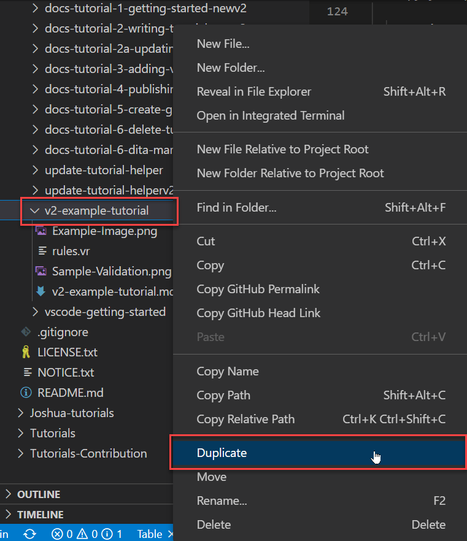
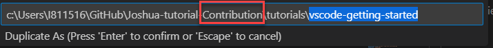
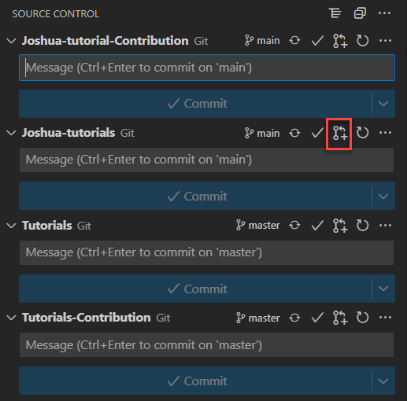
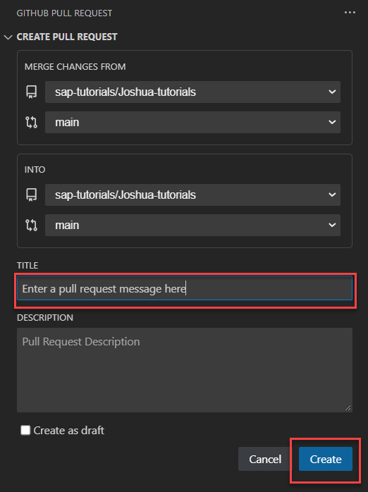
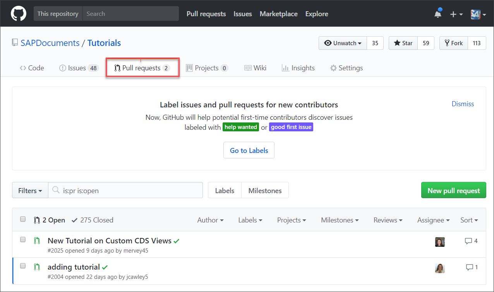

# Publish a Tutorial to Production (v2 parser)
<!-- description --> Learn how to publish your tutorial to the live SAP developer's Tutorial Navigator.

## You will learn  
  - How to move your tutorial to your fork
  - How to request to move your tutorial to production

## Intro
To publish a tutorial, your finished tutorial is copied from the `Tutorials-Contribution` repository to your fork of the `Tutorials` repository. You must do this because you don't have access to the production `Tutorials` repository in the `sap-tutorials` account.

You then request that the tutorials be merged into the production `Tutorials` repository in the `sap-tutorials` account, by creating a pull request, which asks the `sap-tutorials` account to pull your changes into their repository.

>Instructions for how to do this using Visual Studio Code can be found in [Use Visual Studio Code to Author Tutorials](vscode-getting-started).

Once in the production repository, an automatic process creates the tutorial page in the live [**Tutorial Navigator**](https://developers.sap.com/tutorial-navigator.html), usually within 5 minutes.

>**IMPORTANT!** Only move your tutorial to production once you have checked your tutorial (i.e., proofread, edited, checked the images), and once a local colleague and the evangelist for your area have reviewed and approved the tutorial.
>
>Some things to look out for:
>
> - Can the tutorials be done without any special license?
  - Is all the text formatted OK?
    - Numbering is continuous.
    - Indents and spacing OK.
  - Are the images up-to-date?
  - Do the images show proprietary information (e.g., user IDs, URLs)
  - Are the titles and step titles in the correct format (i.e., start with simple verb, title case for titles, sentence case for steps).
  - Do all SAP names (of products and services) conform to branding guidelines. If you're not sure, check with the [Approved names](https://www.sapbrandtools.com/naming-center/#/search/status-search) and with your local User Assistance professional.


### Publish your tutorial to production

1. Before publishing your tutorial to the production repository, please be sure that you check it in the QA instance of the [Tutorial Navigator](https://developers-prod-aqua.wcms-prod.c.eu-de-2.cloud.sap/tutorial-navigator.html)
   
2. Once the quality of your tutorial has been assured, you will need to copy it into your local fork of the repository.  Right click on the tutorial folder that you wish to publish to production and select `Duplicate`.
   
	

3. Edit the path that is presented to you so that the folder is duplicated to the production repository.  This is typically achieved by removing the `-Contribution` from the path, but this might vary.
   
	

4. If the tutorial already exists, then you will get a message confirming that you wish to overwrite the existing file (the answer is "Yes").  If it is a new file, it will write into the folder without a warning message.
   
5. In order to push the changes to production, you will need to select `Commit and Push` from the drop down for the respective repository in the Source Control (VS Code).
   >If you are not using VS Code, please follow the process to Stage, Commit, and Push your changes to your repository fork.
   
6. If you make changes on a forked repository, as many of us do, you will need to submit a pull request in order for your changes to be merged with the repository's main branch.
	- Navigate to Source Control and select the `Create Pull Request` button.
  
	
	
	- Enter a message in the title field (mandatory) and a description (optional), then select the `Create` button.  Typically, you will see the list of commits in the pull request as well.
  
	

>You may also create pull requests directly in your fork of GitHub.

>If you previously created a pull request that has not yet been merged or closed, then your new changes are automatically added to the existing pull request and you do not have to create a new pull request (and you can skip this step).

7. You can check your pull request by going to the [list of open pull requests](https://github.com/sap-tutorials/Tutorials/pulls) for the `sap-tutorials/Tutorials` repository. Yours should be listed there.

  

Someone on the evangelists/tutorial team will review your changes and, if all is OK, merge them into the production repository. Within 10 minutes they will appear on the production website.

### Troubleshooting

#### Cannot push to fork

If your fork gets messed up for some reason and you cannot push to production, then reset your fork.

1. Open a command prompt to your local fork repository.

2. Run the following command:

    > **CAUTION:** This will remove any changes in your local copy of your fork, and your remote fork on GitHub. Generally, this is not a problem, since you have everything in QA, but you should know.

    ```Git
      git fetch upstream && git reset --hard upstream/master && git push origin master --force
    ```

3. Try again to select your tutorial folder in QA and follow the process above in the step entitled **Publish your tutorial to production**.

#### Cannot push to production (admins)

If your local clone of the production repository gets messed up for some reason and you cannot push to production, then reset your local repository.

1. Open a command prompt to your local repository.

2. Run the following command:

    > **CAUTION:** This will remove any changes in your local copy of the production database. Generally, this is not a problem, since you have everything in QA, but you should know (and if you have publishing privileges, you should know better).

    ```Git
    git fetch origin && git reset --hard origin/master
    ```

3. Try again to select your tutorial folder in QA and follow the process above in the step entitled **Publish your tutorial to production**.
