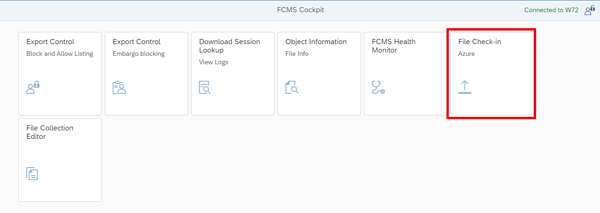
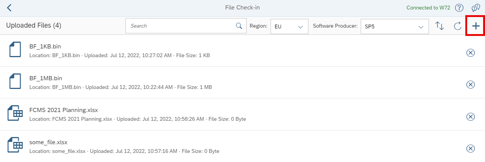
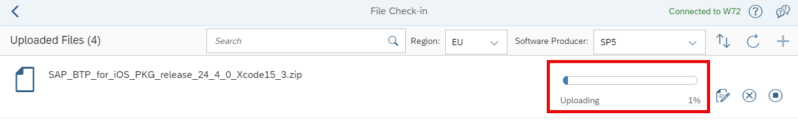
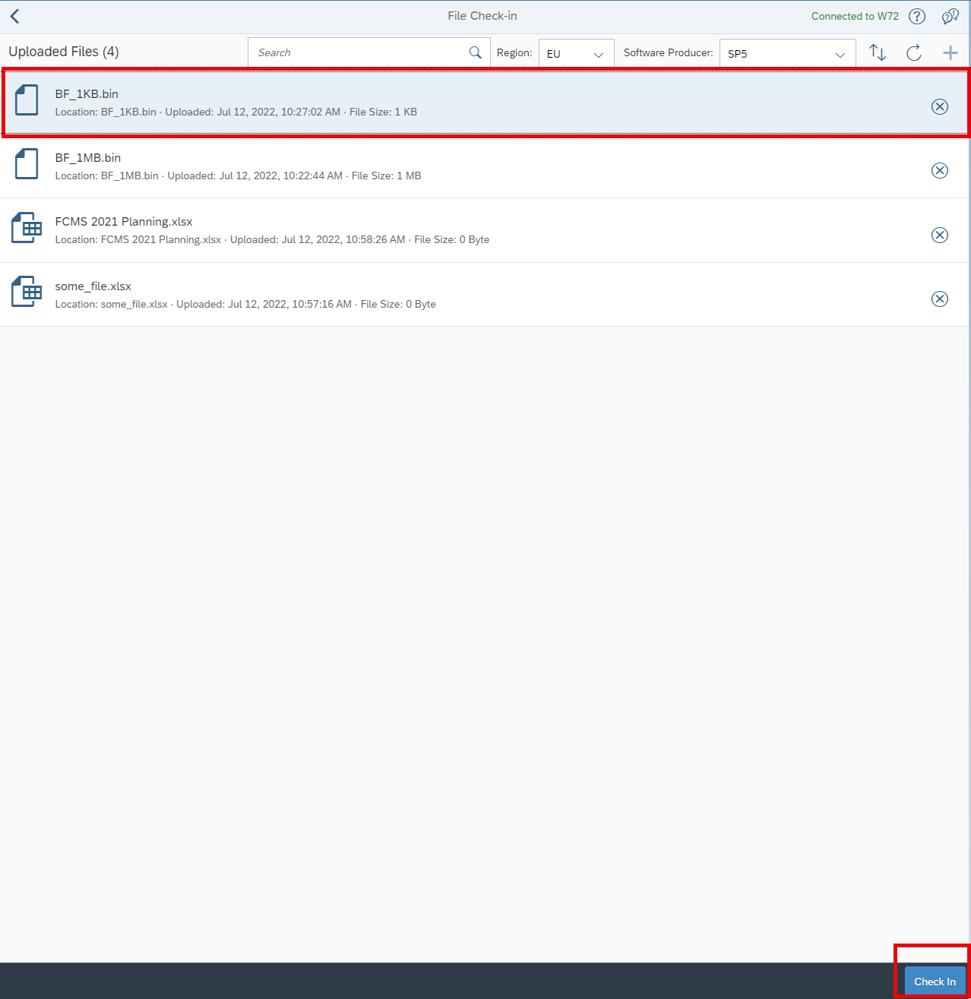
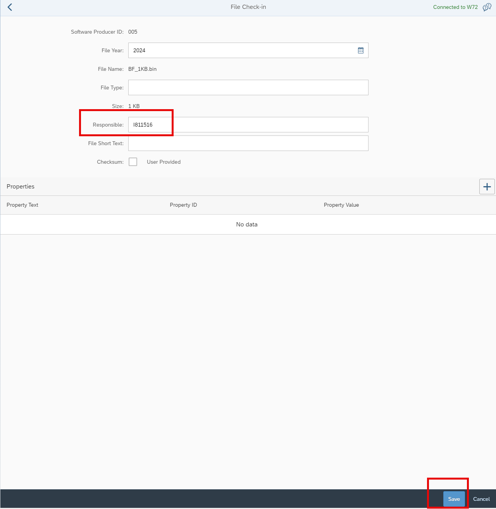
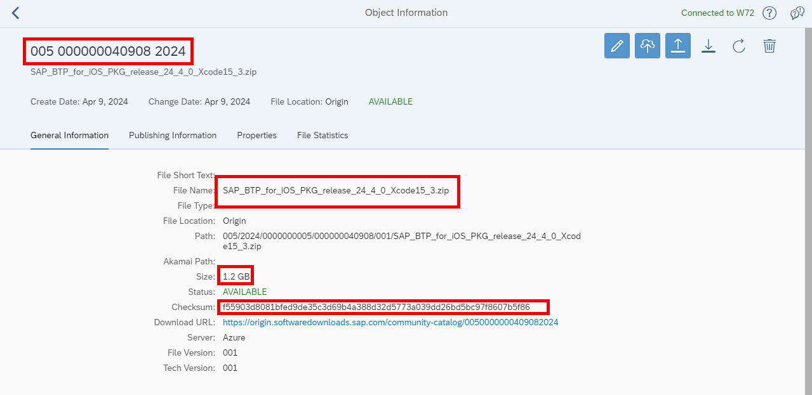
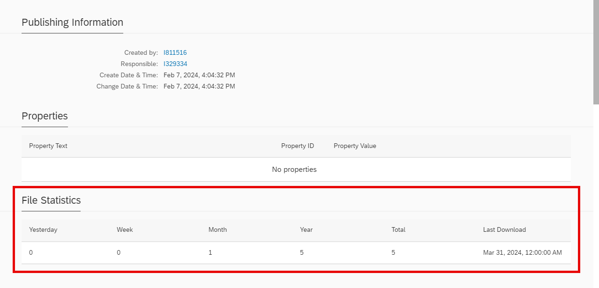

# Upload Files to FCMS for Developer Downloads
<!-- description --> In order to add files to the developer download page, you need to first add them to FCMS (our file management system).  This tutorial will teach you how to upload and check in the file as well as which data to forward to the page management team so the page can be updated.

## You will learn
- How to gain access to FCMS
- How to upload and check-in a file to FCMS
- Which data elements to provide in order to update the page

## Prerequisites
- Access to [FCMS](https://fcmscockpit-supportportal.dispatcher.hana.ondemand.com/index.html#)
- Access to file that is to be uploaded to the file share (FCMS)
- Access to [Digital Services Request Tool](https://dsrequest.int.sap/home?returnUrl=https:%2F%2Fdsrequest.int.sap%2Flist%2F0)

## Intro
>Check this [link to FCMS](https://fcmscockpit-supportportal.dispatcher.hana.ondemand.com/index.html#) to confirm you have access.  If so, proceed to step 1 below.  If not, you can request access to FCMS by sending an email to <sunanjit.saikia@sap.com> and <andrei.kavalionak@sap.com>.  Include in your note that you should be assigned the `SP5 publishing role`.

### Access FCMS and add a file

1. In your browser, navigate to [FCMS Cockpit](https://fcmscockpit-supportportal.dispatcher.hana.ondemand.com/index.html#) and select `File Check-in`.

	

2. Select the `+` to add a file.  Select the appropriate file from the file browser.

	

3. As the file is being uploaded, you can check the status of the upload with the progress bar.

	

### Check in the file

After the file is uploaded, you need to check it in.

1. If you do not see the file in the list after the upload is complete, refresh your browser.

2. Select the file that you wish to check in.  Select the `Check in` button to begin the check in.

	

3. Update the `Responsible` field in the **File Check-in** dialog box with the appropriate user ID.

	

4. Select `Save`.

5. A confirmation message will be displayed where you have the option to view the data.

### Extract the data for the Digital Services Request Tool

1. You will need to add the following information to the Digital Services Request Tool in order for the Download page to be updated.

	

	- File ID
	- File name (with `.zip` or other extension)
	- Size
	- Checksum (a SHA-256 checksum of the file contents as uploaded: on Mac `shasum -a 256 [file_name]` on PowerShell `Get-FileHash C:\path\to\your\file.exe`)
  
  2. You can always come back to *FCMS Cockpit-->Object Information* to check the download statistics on the file.

	

### Submit a digital services request

1. Access the [Digital Services Request Tool](https://dsrequest.int.sap/home?returnUrl=)

2. Click on `Requests` on the top menu and then click on the `+` to begin a new request.

3. Expand the **Web Publishing: developers.sap.com** option

4. Select the **DEV - Trials / Download Update** option

5. Complete the data in the following fields:

	- Request Title
	- Additional Requests and Notification Recipients as required (optional)
	- Type
	- Name of new version (include version number)
	- Package name
	- Remove old version (If `Yes`, then current version will be removed from page.  If `No`, then new version will be added above current version.)
	- New Bundle
	- Publishing option (set to `No` approval step if you want this expedited.)
	- Add the following information in the **Comments** box (available as described in the previous step):
  
    	- File ID
    	- File name
    	- Size
    	- Checksum
  
  	- Change the status to `Open` and save the request.