# Introduction to the Tutorial Dashboard
<!-- description --> The Tutorial Dashboard was created to help tutorial owners and authors manage the lifecycle of their tutorials and to ensure that tutorials are periodically reviewed, updated, or removed as products evolve.

## You will learn
- How to access the Tutorial Dashboard
- How to search and filter the Tutorial Dashboard
- How to use the Tutorial Dashboard to manage the lifecycle of your tutorial(s) 

## Prerequisites
- Access to the tutorial dashboard

## Intro
- The Tutorial Dashboard was created to assist tutorial owners and authors in the lifecycle management of their tutorials.  Specifically, the dashboard allows tutorial owners to view the last time a tutorial was updated, to mark a tutorial as reviewed, and to receive reminder emails when tutorials require a review. 

- Reminder emails will be sent in the following sequence:
    1. When the last updated date is older than six (6) months
    2. Thirty (30) days after number 1.
    3. Thirty (30) days after number 2.
    4. Thirty (30) days after number 3.  *This email is sent only to the sap-tutorials organization owners.*

- If no action is taken after #4, the organization owners will remove the tutorial from production.

### Access the Tutorial Dashboard
- You can access the Tutorial Dashboard [here](https://imsprod-approuter.cfapps.us30.hana.ondemand.com/ui/tutorialDashboard)
  
>If you are unable to access the Tutorial Dashboard (see step #1), please contact [Riley Rainey](mailto:riley.rainey@sap.com).

- By default, the dashboard will show tutorials in groups of twenty.  You can change this by selecting a different number to view.  This selector is located at the bottom right of the page.
  
- You can toggle between results pages by using the forward and backward arrows or selecting a page number.  This selector is located at the bottom-middle of the page.

  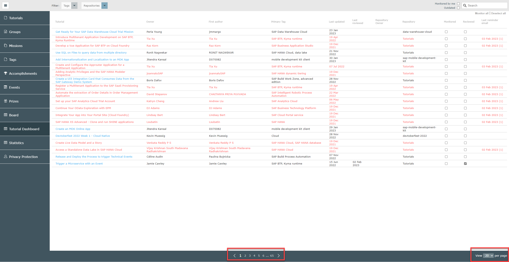

### Filter on tags and repositories

There are several ways to filter the results data on the Tutorial Dashboard.

1. Filter on tags
   
      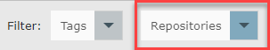

    - You can select as many tags as apply
   
      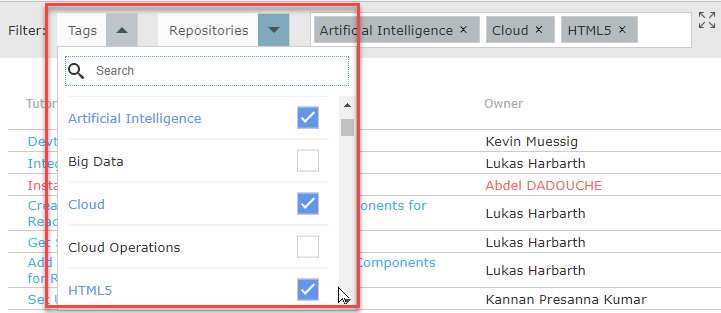

    - Tags will appear in the selected filters box.

      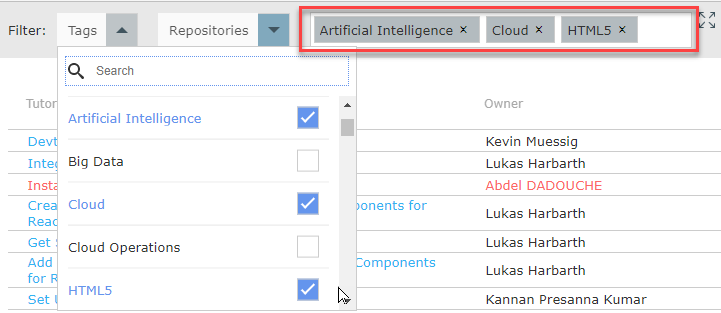

2. Filter on repositories

      

      You can select as many repositories as apply

      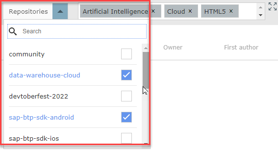

3.  Expand the selected filter box by clicking on the `expand` button to view all selected filters.  From here you can remove specific tag by clicking on the `x` next to the tag.  You can close the box or clear it with the respective buttons at the top right.

    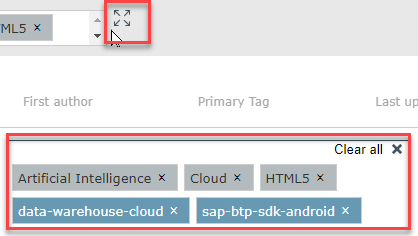

### Filter by keyword search

1. Use the search box at the top right to search by a text string.

	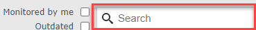

	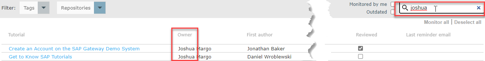

### Filter by monitored by me and outdated

1. Select the `Monitored` checkbox for any tutorial you wish to monitor.  When the `Monitored by me` filter checkbox is selected the result list will be filtered respectively.

    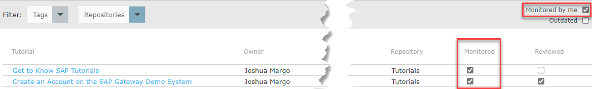

2. Select the `Outdated` checkbox to display tutorials in the results that are in need of review (over 6 months since the last update)

    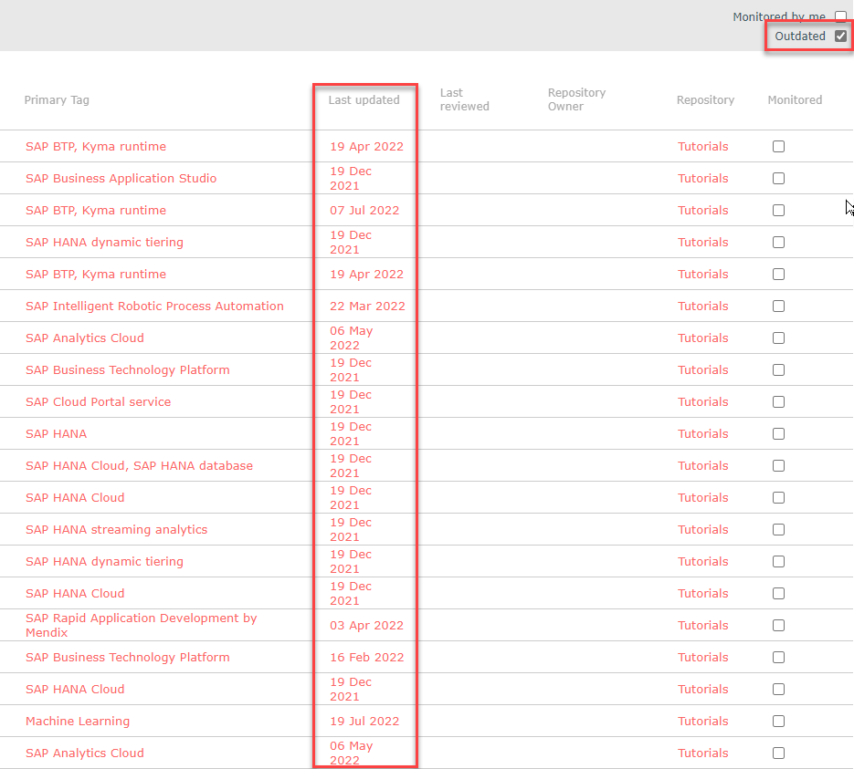

3. Use the `Monitor all` to select every tutorial on the current results page for monitoring.  Conversely, you can use the `Deselect all` to deselect any tutorials selected for monitoring on the current results page.

	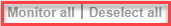

### Reset the date with a review

   After you review the tutorial and take action, click the `Reviewed` checkbox next to the respective tutorial.  This will reset the clock for another six (6) months.

   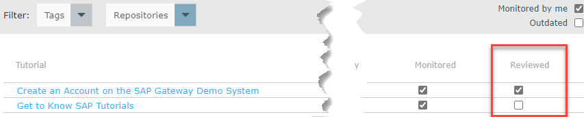

### Knowledge Check
