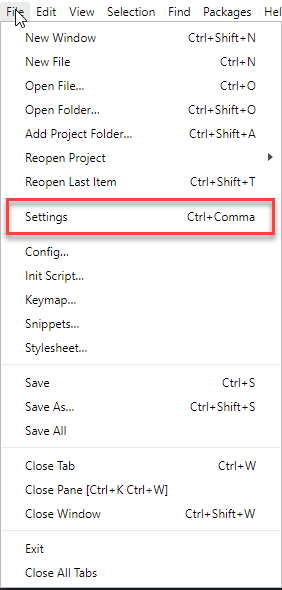
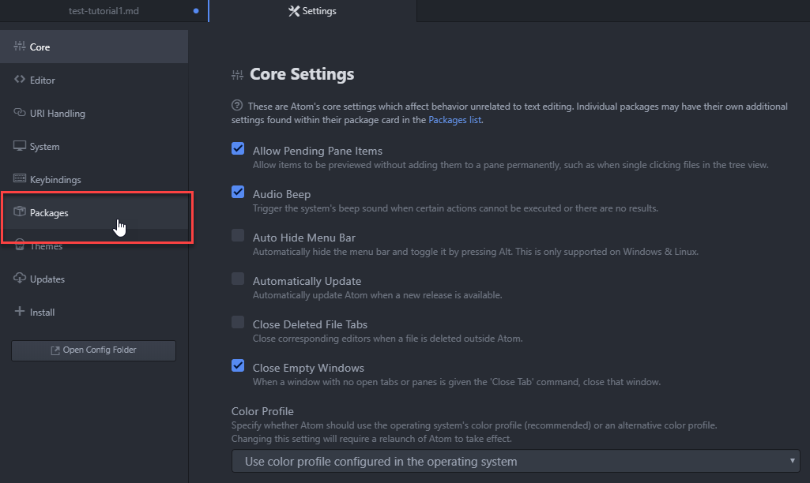
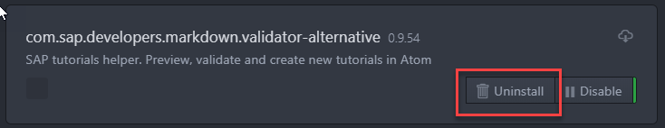
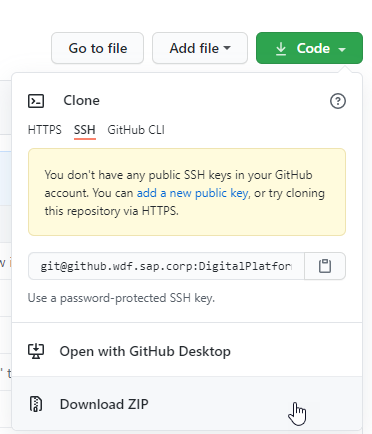

## Prerequisites
 - GitHub account
 - Atom editor installed with SAP Tutorial Helper plug-in installed
 
## Details
### You will learn
  - How to uninstall the current version of the Tutorial Helper plug-in
  - How to access and download the new version of the Tutorial Helper plug-in
  - How to install the new version of the Tutorial Helper plug-in

Add additional information: Background information, longer prerequisites

---

[ACCORDION-BEGIN [Step 1: ](Uninstall the current version of Tutorial Helper plug-in)]

1.  Open **`Atom`**

2.  Select **File>Settings**

    

3.  Select **`Packages`**

    

4.  Select **`Uninstall`** to remove the current version

    

5.  Close the `Atom` editor

[DONE]
[ACCORDION-END]

[ACCORDION-BEGIN [Step 2: ](Download the new version of the Tutorial Helper plug-in)]

1.  Go to TBD

2.  Select `alternative` from the branch drop down menu

    

3.  Select the `Download ZIP` option from the **`Code`** menu

    

4.  Make a note of where you download the `com.sap.developers.markdown.validator-alternative.zip` file    

[DONE]
[ACCORDION-END]

[ACCORDION-BEGIN [Step 3: ](Install the new version of the Tutorial Helper plug-in)]

1.  Navigate to the zip File

2.  Extract the file to your preferred location

    It does not matter to which location you extract it, just make a note of it.

3.  Open the extracted file and open the `install` folder

4.  Double-click the `win.bat` file

    The install program will run in a command dialog box

[DONE]
[ACCORDION-END]

[ACCORDION-BEGIN [Step 4: ](Confirm that the new version installed)]

1.  Open **`Atom`**

2.  Select **File>Settings**

    

3.  Select **`Packages`**

    

4.  Confirm that the `com.sap.developers.markdown.validator-alternative` file is listed under the **Community Packages** section

[VALIDATE_1]
[ACCORDION-END]

---
