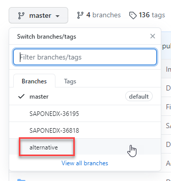

# Prepare Atom Editor for Individual Repos
<!-- description --> Prepare your version of the Atom editor to write and publish with individual GitHub repositories.

## Prerequisites

 - GitHub account
 - Atom editor installed with SAP Tutorial Helper plug-in installed

## You will learn

  - How to *uninstall* the current version of the Tutorial Helper plug-in
  - How to access and download the new version of the Tutorial Helper plug-in
  - How to install the new version of the Tutorial Helper plug-in

### Introduction to Uninstall the current version of Tutorial Helper plug-in

[OPTION BEGIN [Player 1]]

1.  Open **`Atom`**

2.  Select **File>Settings**

    <!-- size:200px -->  <iframe width="560" height="315" src=https://www.youtube.com/embed/do_UT5NqAO0 frameborder="0" allow="accelerometer; autoplay; encrypted-media; gyroscope; picture-in-picture" allowfullscreen></iframe> 
  
     

3.  Select **`Packages`** 

4.  Select **`Uninstall`** to remove the current version

    

5.  Close the `Atom` editor

[OPTION END]

[OPTION BEGIN [Player 2]]

This is the Player 2 instruction.

[OPTION END] 

### Download the new version of the Tutorial Helper plug-in

1.  Go to TBD

2.  Select `alternative` from the branch drop down menu

    

3.  Select the `Download ZIP` option from the **`Code`** menu

    

4.  Make a note of where you download #### the `com.sap.developers.markdown.validator-alternative.zip` file    

### Install the new version of the Tutorial Helper plug-in

1.  Navigate to the zip File

2.  Extract the file to your preferred location

    It does not matter to which location you extract it, just make a note of it.

3.  Open the extracted file and open the `install` folder

4.  Double-click the `win.bat` file

    The install program will run in a command dialog box

### Confirm that the new version installed

1.  Open **`Atom`**

2.  Select **File>Settings**

    

3.  Select **`Packages`**

    

4.  Confirm that the `com.sap.developers.markdown.validator-alternative` file is listed under the **Community Packages** section

---
