# Use Visual Studio Code to Author Tutorials
<!-- description --> Deprecated: Use the Sage VS Code Extension for most authoring tasks. This tutorial covers the basic set-up and optimization of Visual Studio Code as a developer tutorial authoring tool.

## You will learn
- How to author .md and .vr files in Visual Studio Code
- Which extensions to install to improve GitHub publishing efficiency
- How to publish your tutorials to the QA environment
- How to copy and publish your tutorials to the production environment

## Prerequisites
- Visual Studio Code (for Mac or Windows) is installed
- You have cloned the GitHub repositories in which you work

## Introduction
**This tutorial is deprecated.**  All of the actions described here are replaced with a dedicated SAP-owned VS Code extension called [Sage](https://github.tools.sap/I838039/sage-tutorial-extension/blob/main/README.md). You can review the steps for installing and using Sage in [this Tutorial](https://developers-prod-aqua.wcms-prod.c.eu-de-2.cloud.sap/tutorials/sage-getting-started.html).  **We're retaining this tutorial only for those who'd like a deeper understanding of how the Tutorial system interacts with GitHub.**

The principles in this tutorial regarding authoring and publishing are applicable to any markdown editor.  Please keep in mind that the extent to which features and functions are available across editors may vary.

### Link your cloned repositories to VS Code
1. When you first open VS Code, your explorer pane will be empty.  The explorer pane is accessible from the icon indicated in the image.
   
	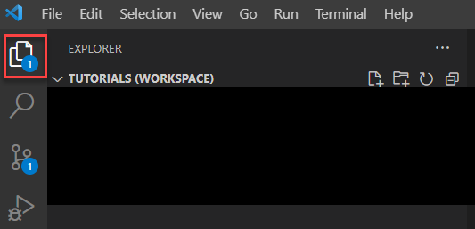

2. To add folders (i.e., cloned repositories) select `File` from the top menu bar and then select `Add Folder to Workspace`
   
	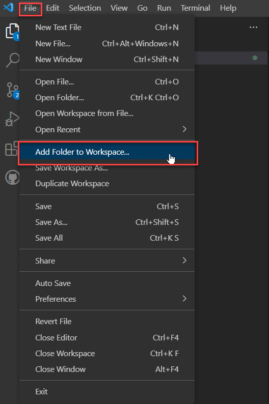

3. From the selection dialog box, select the folders you want to add and then click the `Add` button.
   
	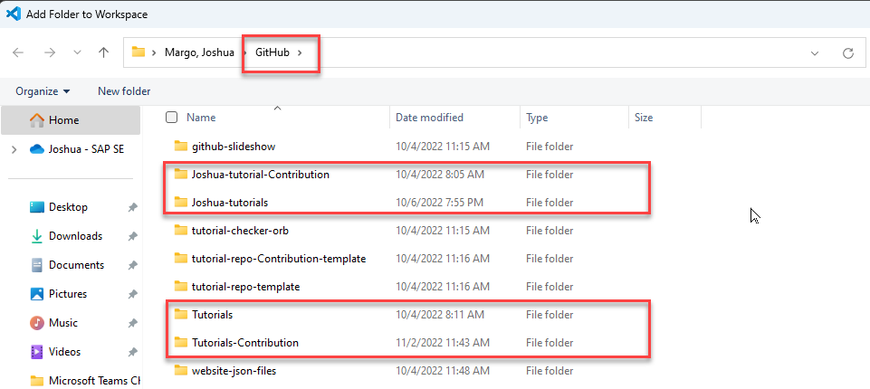

4. You will now see the selected folders in the VS Code Explorer pane.
   
	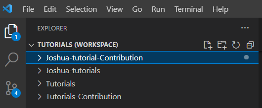

### Set up useful extensions
1. Navigate to the Extensions icon on the left side of the screen.
   
	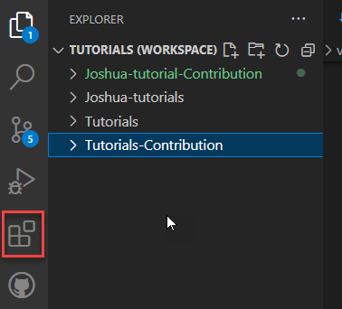

2. Your `INSTALLED` section counter should be blank or 0.  There are two extensions that we recommend you install to make using VS Code easy and efficient.  Click in the text box labeled with `Search Extensions in Marketplace`.
   
	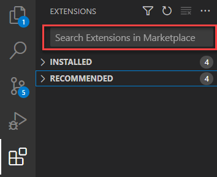

      - Enter `GitHub Pull Requests and Issues` and then install the extension.
  
      - Enter `File Utils` and then install the extension.
  
		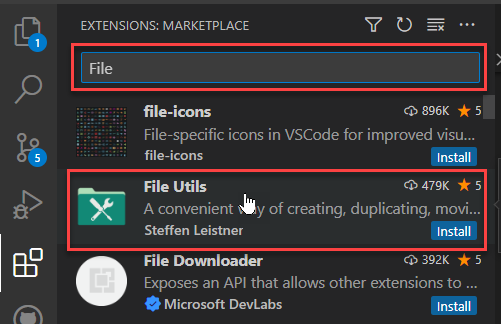 
	
3. In your Extensions pane, you should now see the two installed extensions under the `INSTALLED` section.
   
	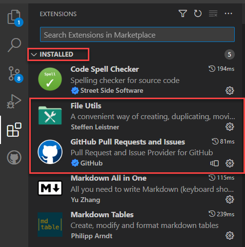

### Create new tutorial

>Remember to execute a pull command in each repository **BEFORE** working on your tutorials.  This is done through the Source Control pane.  You may also need to manually synchronize your fork in GitHub before pulling.

>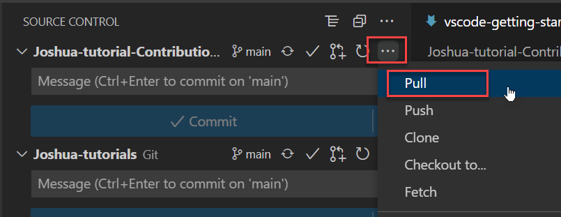

1. To create a new tutorial, navigate to your respective Contribution folder (either `Tutorials-Contribution` or to your individual contribution repository).
   
2. Right click on the `tutorials` folder so that VS Code know where to place the folder for your new tutorial.
   
	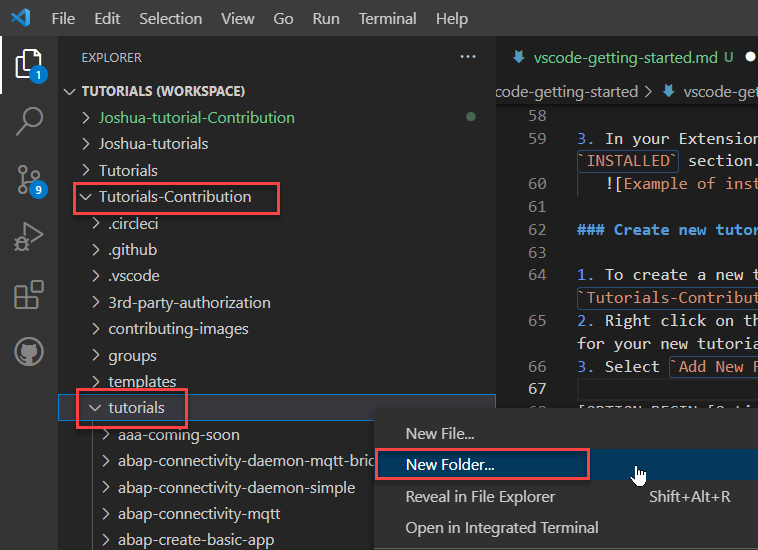

3. Select `New Folder` and enter a name for the tutorial folder.
   
	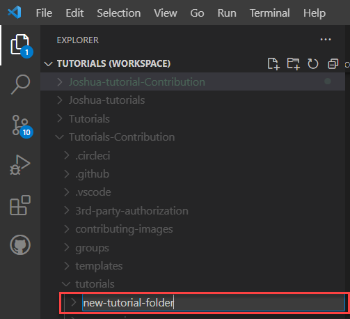

4. To create your new markdown file, right-click on the folder you just created and select `New File`.
   
	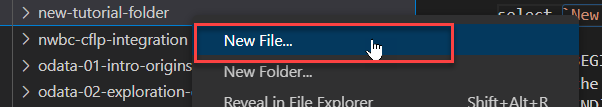

5. Enter the file name (remember to match the folder name) and append it with ".md"  An icon will now appear to the left of the file name indicating that it is a markdown file.  You follow the same process to create your `rules.vr` file.
   
	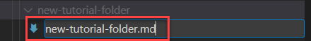

>If you add .png files through a screen capture process, like SnagIt, and save them directly to the tutorial folder, they will appear automatically in the Explorer pane.

### Publish your tutorial to QA

1. Navigate to the `Source Control` icon.
   
	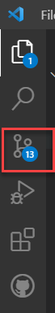

2. Enter a commit message.
   
	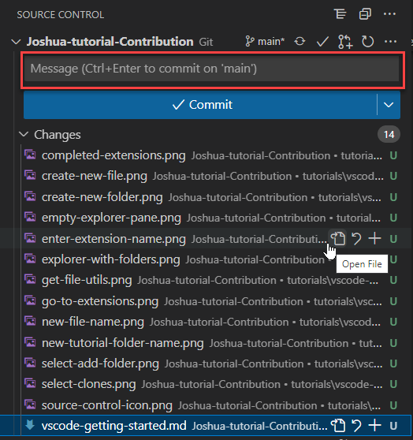

3. Select the down-arrow next to the `Commit` button and select `Commit & Push`.  The system will generate a message asking if you want to stage your commits.  You can select **Yes** for a one-time staging or **Always** if you prefer not to be asked this question again.
   
	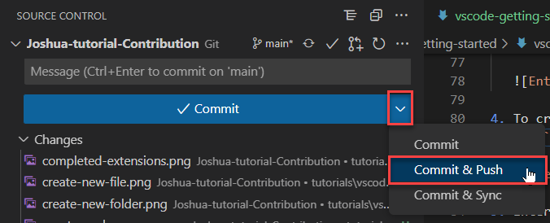

	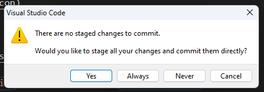

4. As all tutorial authors have write access to the Contribution repository, a pull request is not required at this point.  That will be covered in the next step.

### Publish your tutorial to production

1. Before publishing your tutorial to the production repository, please be sure that you check it in the QA instance of the [Tutorial Navigator](https://developers-prod-aqua.wcms-prod.c.eu-de-2.cloud.sap/tutorial-navigator.html)
   
2. Once the quality of your tutorial has been assured, you will need to copy it into your local fork of the repository.  Right click on the tutorial folder that you wish to publish to production and select `Duplicate`.
   
	

3. Edit the path that is presented to you so that the folder is duplicated to the production repository.  This is typically achieved by removing the `-Contribution` from the path, but this might vary.
   
	

4. If the tutorial already exists, then you will get a message confirming that you wish to overwrite the existing file (the answer is "Yes").  If it is a new file, it will write into the folder without a warning message.
   
5. At this point, you should follow steps 1-3 of the previous step in order to push the changes to production.
   
6. If you make changes on a forked repository, as many of us do, you will need to submit a pull request in order for your changes to be merged with the repository's main branch.
	- Navigate to Source Control and select the `Create Pull Request` button.
  
		
	
	- Enter a message in the title field (mandatory) and a description (optional), then select the `Create` button.  Typically, you will see the list of commits in the pull request as well.
  
		
>You may also create pull requests directly in your fork of GitHub as was previously done.
### Knowledge Check
